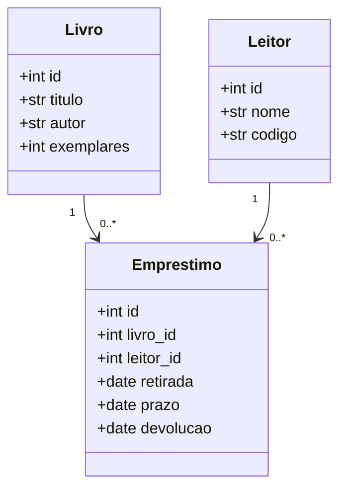
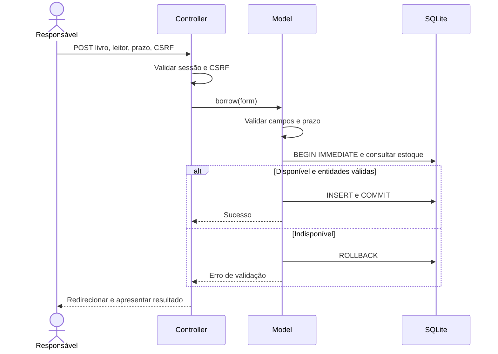
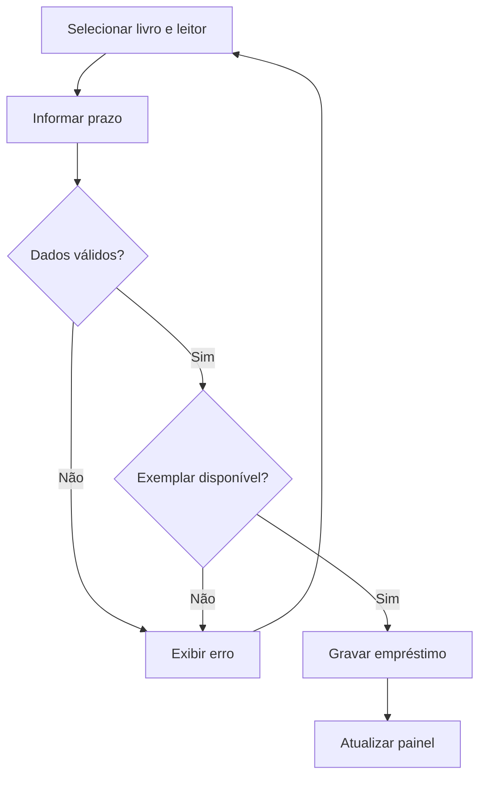

# Modelagem UML e dados

Os diagramas Mermaid abaixo podem ser visualizados no GitHub. O diagrama de classes representa entidades de persistência; funções de serviço em models.py implementam as operações.

## Classes

## Casos de uso (especificação textual)

Ator: responsável autenticado. UC01 Cadastrar livro; UC02 Cadastrar leitor; UC03 Consultar acervo; UC04 Emprestar livro; UC05 Registrar devolução; UC06 Consultar situação e histórico. Autenticar é precondição de todos. Leitor é entidade participante do negócio, não usuário direto da interface.

UC04: precondições livro/leitor cadastrados e estoque positivo. Fluxo: escolher livro, leitor e prazo; enviar; validar; iniciar transação; conferir estoque; gravar; confirmar. Alternativas: entrada inválida retorna mensagem; estoque esgotado não grava. Pós-condição: empréstimo ativo persistido e disponibilidade reduzida em uma unidade.

UC05: precondição empréstimo ativo. Fluxo: escolher Devolver, confirmar, gravar data do servidor, mostrar confirmação. Alternativas: cancelar mantém estado; ID inexistente ou já devolvido não atualiza. Pós-condição: histórico preservado, disponibilidade acrescida em uma unidade.

## Sequência do empréstimo

## Atividades

